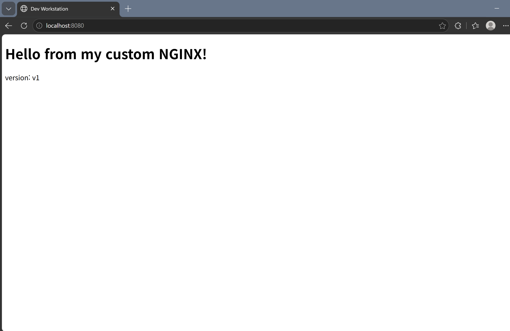
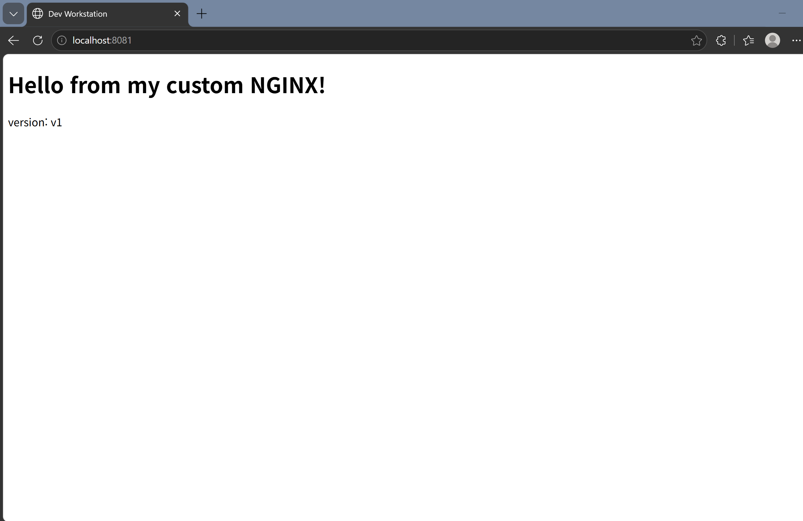
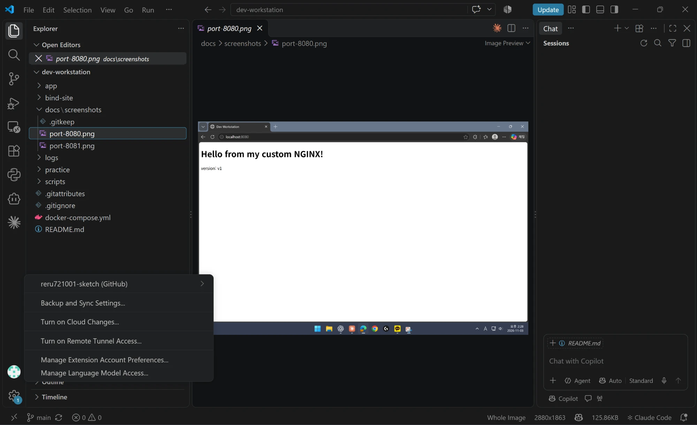

# 미션 E1-1 : 내 컴퓨터에 개발자용 '작업실' 꾸미기

> 개발 워크스테이션 구축 (Terminal · Docker · Git)

## 0) 개요
터미널, Docker, Git을 직접 써 보고 결과를 정리한 저장소입니다.
- 터미널로 파일·폴더를 다루고 권한을 바꿔 봤습니다.
- Docker로 웹 서버를 만들어 브라우저로 접속해 봤습니다.
- 결과물을 Git으로 GitHub에 올렸습니다.

실행 결과는 모두 `logs/` 폴더에 있고, `scripts/` 를 실행하면 똑같이 다시 할 수 있습니다.

### 폴더 구성
**만드는 것(app) / 실행하는 것(scripts) / 결과(logs, docs)** 를 나눠서, 어디에 뭐가 있는지 바로 찾을 수 있게 했습니다.

| 폴더·파일 | 역할 | 이렇게 나눈 이유 |
|---|---|---|
| `app/` | 웹 서버 소스(`site/index.html`) + `Dockerfile` | 이미지 만드는 데 필요한 것만 모아서 `docker build ./app` 한 줄로 빌드 |
| `scripts/` | 실습 명령을 순서대로 적은 파일 (01~04) | 누가 실행해도 같은 순서로 다시 할 수 있게 |
| `logs/` | 스크립트 실행 결과 (명령 + 출력) | 증거를 한곳에 모음. 스크립트 번호와 같은 이름 |
| `docs/screenshots/` | 브라우저·VSCode 화면 | 글로 남기기 어려운 증거 |
| `docker-compose.yml` | 보너스: 컨테이너 2개 설정 | Compose 기본 위치(프로젝트 맨 위) |
| `.gitignore` | 올리면 안 되는 파일 목록 | 비밀 정보(`.env`, `*.key`)와 연습용 폴더 제외 |

## 1) 실행 환경
| 항목 | 값 |
|---|---|
| OS | Windows 11 Pro |
| 쉘 / 터미널 | Git Bash (bash 5.3) |
| Docker | Docker Desktop 4.97.0 (Engine 29.9.2) |
| Git | 2.56.0 |

## 2) 체크리스트 · 검증 방법
| 항목 | 확인한 명령 | 확인한 것 | 결과 |
|---|---|---|---|
| ✅ 터미널 | `mkdir`, `cp`, `mv`, `rm`, `ls` | 파일·폴더 만들기/복사/이동/삭제 | [3)](#3-터미널), [로그](logs/01_terminal_perm.txt) |
| ✅ 권한 | `chmod`, `ls -l` | 바꾸기 전/후 비교 | [4)](#4-권한), [로그](logs/02_docker.txt) |
| ✅ Docker 설치 | `docker --version`, `docker info` | 설치·실행 여부 | [5)](#5-docker-설치--운영), [로그](logs/02_docker.txt) |
| ✅ Docker 운영 | `images`, `ps -a`, `logs`, `stats` | 이미지·컨테이너 상태 | [5)](#5-docker-설치--운영), [로그](logs/02_docker.txt) |
| ✅ Dockerfile | `docker build`, `docker run` | 내 페이지가 뜨는지 | [6)](#6-dockerfile-웹-서버), [로그](logs/02_docker.txt) |
| ✅ 포트 | `-p 8080:80`, `-p 8081:80` | 브라우저 접속 | [7)](#7-포트-접속) |
| ✅ 바인드 마운트 | `-v 폴더:경로` | 수정 전/후 비교 | [8)](#8-바인드-마운트), [로그](logs/02_docker.txt) |
| ✅ 볼륨 | `docker volume` | 삭제 전/후 비교 | [9)](#9-볼륨), [로그](logs/02_docker.txt) |
| ✅ Git / GitHub | `git config`, VSCode | 설정·연동 | [10)](#10-git--github) |
| ✅ (보너스) Compose | `docker compose` | 컨테이너 2개 동시 실행 | [11)](#11-보너스-compose), [로그](logs/03_compose.txt) |

---

## 3) 터미널
```bash
$ mkdir -p docs backup                  # 폴더 만들기
$ echo "hello codyssey" > note.txt      # 파일 만들기
$ ls -la                                # 목록 보기
drwxr-xr-x  backup
drwxr-xr-x  docs
-rw-r--r--  note.txt
$ cp note.txt backup/note_copy.txt      # 복사
$ mv note.txt docs/renamed.txt          # 이동 + 이름 바꾸기
$ rm backup/note_copy.txt               # 삭제
```
- **절대 경로**: `/` 부터 전부 적은 경로. 어디서든 같은 곳.
- **상대 경로**: 지금 위치 기준 경로(`../`). 위치에 따라 달라짐.

## 4) 권한
Windows에서는 `chmod` 가 적용되지 않아서 우분투 컨테이너 안에서 했습니다.
```bash
$ chmod 755 f.txt; ls -l    -rwxr-xr-x  f.txt   # 644 → 755
$ chmod 700 d; ls -ld d     drwx------  d       # 755 → 700
```
- 숫자 = 읽기(4) + 쓰기(2) + 실행(1), 세 자리는 **나 / 그룹 / 다른 사람**

| 숫자 | 글자 | 뜻 | 주로 쓰는 곳 |
|---|---|---|---|
| 755 | `rwxr-xr-x` | 나는 전부, 남은 읽기·실행 | 폴더, 실행 파일 |
| 644 | `rw-r--r--` | 나는 읽기·쓰기, 남은 읽기만 | 일반 파일 |
| 700 | `rwx------` | 나만 전부 | 나만 쓰는 폴더 |

## 5) Docker 설치 · 운영
```bash
$ docker --version
Docker version 29.9.2
$ docker info              # Server 정보가 나오면 실행 중
Server Version: 29.9.2
$ docker run --rm hello-world
Hello from Docker!
$ docker images
hello-world   25.9kB
ubuntu        119MB
$ docker ps -a
my-web-8080   Up (healthy)   0.0.0.0:8080->80/tcp
my-web-8081   Up (healthy)   0.0.0.0:8081->80/tcp
$ docker logs my-web-8080
"GET / HTTP/1.1" 200
$ docker stats --no-stream
my-web-8080   CPU 0.00%   MEM 14.97MiB
```
**attach vs exec** ([로그](logs/04_attach_exec.txt))
- `attach`: 컨테이너의 메인 프로그램에 연결 → exit 하면 **컨테이너 꺼짐**
- `exec`: 새 프로그램을 하나 더 실행 → exit 해도 **컨테이너 계속 실행**

## 6) Dockerfile 웹 서버
소스: [app/site/index.html](app/site/index.html) · [app/Dockerfile](app/Dockerfile)

nginx 이미지에 내 홈페이지를 넣어서 새 이미지를 만들었습니다.
- `FROM nginx:1.27-alpine`: nginx 웹 서버 이미지를 바탕으로
- `COPY site/ /usr/share/nginx/html/`: 내 홈페이지를 nginx가 보여주는 폴더에 넣음

### 이미지 vs 컨테이너
| | 이미지 | 컨테이너 |
|---|---|---|
| 뭐냐 | 실행에 필요한 파일을 묶어 둔 것 (**저장**용) | 이미지를 실행한 것 (**실행** 중) |
| 바뀌나 | 안 바뀜 (읽기 전용) | 실행 중에 바뀔 수 있음 |
| 만드는 법 | `docker build` | `docker run` |
| 예시 | `my-web:1.0` 1개 | `my-web-8080`, `my-web-8081` 2개 |

**수정 흐름**: 홈페이지를 바꾸고 싶으면 실행 중인 컨테이너를 고치는 게 아니라,
`index.html` 수정 → `docker build`(새 이미지) → 기존 컨테이너 삭제 → `docker run`(새 컨테이너) 순서로 합니다.
컨테이너 안에서 직접 고친 내용은 컨테이너를 지우면 사라지기 때문입니다.

```bash
$ docker build -t my-web:1.0 ./app
naming to docker.io/library/my-web:1.0 done
$ docker run -d -p 8080:80 --name my-web-8080 my-web:1.0
$ curl http://localhost:8080
<h1>Hello from my custom NGINX!</h1>
```

## 7) 포트 접속
`-p 8080:80` = 내 PC 8080번으로 접속하면 컨테이너 80번으로 연결

**왜 필요한가**: 컨테이너는 **네트워크 네임스페이스**라는 기능으로 자기만의 네트워크(IP, 포트)를 따로 가집니다.
그래서 컨테이너 안의 nginx가 80번에서 돌아가도, 내 PC(호스트)에서는 그 80번이 보이지 않습니다.
`-p` 로 호스트 포트와 컨테이너 포트를 연결(포트 포워딩)해 줘야 밖에서 접속할 수 있습니다.

| 실행 방법 | `docker ps` PORTS 칸 | 브라우저 접속 |
|---|---|---|
| `docker run -d my-web:1.0` (`-p` 없음) | `80/tcp` | ❌ 안 됨 (컨테이너 안에서만 접속 가능) |
| `docker run -d -p 8080:80 my-web:1.0` | `0.0.0.0:8080->80/tcp` | ✅ `localhost:8080` |

같은 이미지라도 호스트 포트만 다르게(8080, 8081) 주면 여러 개를 동시에 띄울 수 있습니다.




## 8) 바인드 마운트
내 PC 파일을 고치면 컨테이너에도 바로 반영됩니다.
```bash
$ docker run -d -p 8082:80 -v "$PWD/bind-site":/usr/share/nginx/html nginx:1.27-alpine
$ curl localhost:8082      # 수정 전
version: v1
$ sed -i "s/v1/v2/" bind-site/index.html     # 내 PC에서 수정
$ curl localhost:8082      # 수정 후
version: v2
```

## 9) 볼륨
컨테이너를 지워도 볼륨에 저장한 데이터는 남습니다.
```bash
$ docker volume create mydata
$ docker run -d --name vol-test -v mydata:/data ubuntu sleep infinity
$ docker exec vol-test sh -c "echo hi > /data/hello.txt"
$ docker rm -f vol-test                      # 컨테이너 삭제
$ docker run -d --name vol-test2 -v mydata:/data ubuntu sleep infinity
$ docker exec vol-test2 cat /data/hello.txt  # 새 컨테이너에서 확인
hi
```

| | 바인드 마운트 | 볼륨 |
|---|---|---|
| 저장 위치 | 내 PC 폴더 (내가 지정) | Docker가 관리하는 공간 |
| 장점 | PC에서 바로 수정·확인 가능 | 컨테이너를 지워도 데이터 유지, OS 상관없이 동작 |
| 단점 | PC 폴더 경로에 따라 달라짐 | 파일을 직접 열어 보기 불편 |
| 주로 쓰는 곳 | 개발 중 소스 수정 | 데이터베이스 등 꼭 남아야 하는 데이터 |

## 10) Git · GitHub
```bash
$ git config --global user.name "손건"
$ git config --global user.email "****@icloud.com"
$ git config --global init.defaultBranch main
$ git config --list
user.name=손건
user.email=****@icloud.com
init.defaultbranch=main
```

**GitHub 원격 저장소 연결**
```bash
$ git remote add origin https://github.com/reru721001-sketch/songeon-codyssey.git
$ git remote set-url origin https://github.com/reru721001-sketch/mission-E1-1.git   # 저장소 이름 변경 후
$ git remote -v
origin	https://github.com/reru721001-sketch/mission-E1-1.git (fetch)
origin	https://github.com/reru721001-sketch/mission-E1-1.git (push)
$ git push -u origin main
$ git branch -vv
* main 0959f4b [origin/main] 실습 로그를 텍스트(.txt)로 정리하고 재실행 결과 반영
```
- `origin`: GitHub 저장소에 붙인 이름
- `[origin/main]`: 내 PC의 main 브랜치가 GitHub의 main과 연결돼 있다는 뜻

VSCode에서 GitHub 로그인 후 저장소와 연결했습니다.



## 11) 보너스: Compose
[docker-compose.yml](docker-compose.yml) 파일 하나로 웹 서버 + Redis를 같이 켰습니다.
```bash
$ docker compose up -d
$ docker compose ps
web     Up   0.0.0.0:8090->80/tcp
cache   Up   6379/tcp
$ docker compose down
```

---

## 12) 트러블슈팅

**#1 Windows에서 `chmod` 가 안 됨**
- 문제: 권한을 바꿔도 그대로였다.
- 원인 가설: Windows 파일 시스템은 리눅스 권한을 지원 안 하는 것 같다.
- 확인: 우분투 컨테이너에서 하니 잘 바뀌었다.
- 해결: 권한 실습은 컨테이너 안에서 했다.

**#2 Docker Desktop이 안 켜짐**
- 문제: "Virtual Machine Platform is not enabled" 오류.
- 원인 가설: 필요한 Windows 기능이 아직 적용 안 된 것 같다.
- 확인: 기능은 켰지만 재부팅을 안 한 상태였다.
- 해결: 재부팅 후 정상 실행.

**#3 로그 파일 경로 오류**
- 문제: `tee: No such file or directory`
- 원인 가설: `cd` 로 폴더를 옮겨서 상대 경로가 틀어진 것 같다.
- 확인: `pwd` 로 보니 다른 폴더에 있었다.
- 해결: 로그 경로를 절대 경로로 바꿨다.

**#4 포트 충돌 (`port is already allocated`)**
- 문제: 이미 8080을 쓰는 컨테이너가 있는데 8080으로 하나 더 실행하니 오류가 났다.
```bash
$ docker run -d -p 8080:80 --name conflict-test my-web:1.0
docker: Error response from daemon: ... Bind for 0.0.0.0:8080 failed: port is already allocated
```
- 원인 가설: 다른 컨테이너(또는 프로그램)가 8080을 이미 쓰고 있는 것 같다.
- 확인: 누가 8080을 쓰는지 순서대로 찾았다.
```bash
# 1) 컨테이너 중에 8080을 쓰는 게 있는지
$ docker ps --filter publish=8080
NAMES         PORTS
my-web-8080   0.0.0.0:8080->80/tcp, [::]:8080->80/tcp

# 2) 컨테이너가 아니면, PC에서 8080을 쓰는 프로그램(PID) 찾기
$ netstat -ano | grep LISTEN | grep :8080
  TCP    0.0.0.0:8080     0.0.0.0:0     LISTENING     25184
$ powershell "Get-Process -Id 25184"
25184 com.docker.backend      # Docker가 my-web-8080 때문에 열어 둔 것
```
- 해결: 둘 중 하나를 선택한다.
  - 기존 컨테이너를 끈다: `docker stop my-web-8080` (컨테이너가 아니면 작업 관리자에서 그 PID 종료)
  - 다른 포트를 쓴다:
```bash
$ docker run -d -p 8083:80 --name conflict-test my-web:1.0
$ curl -s -o /dev/null -w "%{http_code}\n" localhost:8083
200                                   # 접속 성공
```

## 13) 보안
- `.gitignore` 로 비밀 파일(`.env`, `*.key`)이 올라가지 않게 했습니다.
- 이메일 등 개인 정보는 가렸습니다.
